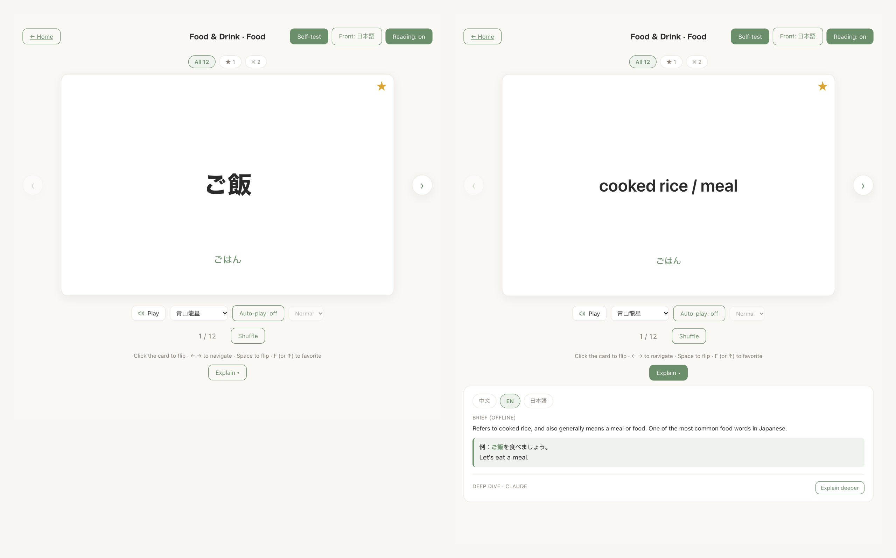
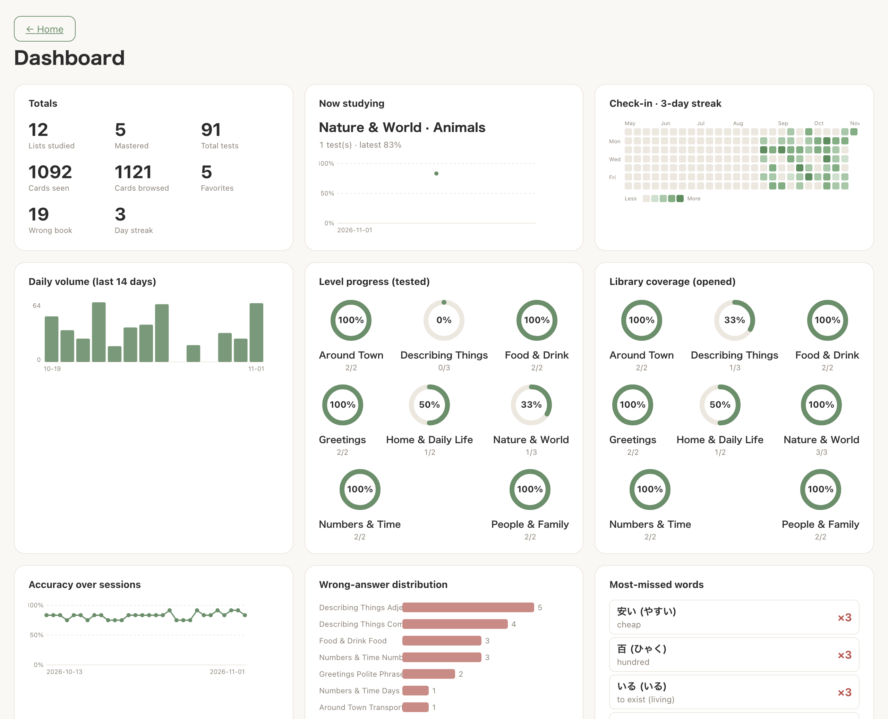
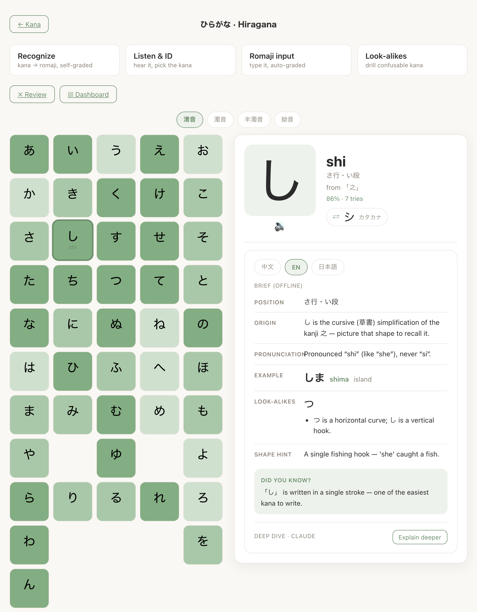
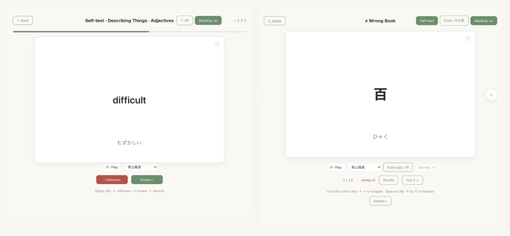

# jp-flashcard

[](https://is-clarkhu.github.io/jp-flashcard/)
[](https://github.com/is-ClarkHu/jp-flashcard/actions/workflows/deploy-pages.yml)
[](LICENSE)

A local, single-user **Japanese vocabulary flashcard app**: flip cards, self-test
with a wrong book, six-voice audio, a kana (五十音) trainer, two-layer AI
explanations and an analytics dashboard. No ads, no server, no login. It runs as a
website, a single offline HTML file, or a desktop app.

**[Open the live demo →](https://is-clarkhu.github.io/jp-flashcard/)** The demo
site carries only a self-authored sample deck (214 words in 18 lists, six
VOICEVOX voices each) and the kana set. It contains no copyrighted word lists. It
works the moment it loads and needs no API key; "Explain deeper" is the only
feature that ever asks for one.

The app itself is not the hard part. The hard part is shipping it four different
ways and keeping a learner's progress alive across all of them. Most of this
README is about that.

---

## Screenshots

**Flip cards.** Japanese on the front, meaning on the back, with per-word audio
and an offline explanation brief (ZH / EN / JP) one click away.



**Analytics dashboard.** Check-in heatmap and streak, daily volume, per-course
progress rings, accuracy over sessions, wrong-answer distribution.



**Kana trainer.** Gojūon board tinted by mastery, and a detail panel with the
source kanji, pronunciation notes, an example word and look-alike tips.



**Self-test and wrong book.** Self-graded Known / Unknown on a shuffled list;
every miss lands in the wrong book, which drains as you get words right.



> The screenshots use the bundled sample deck and a simulated study history
> (about ten weeks of rounds written into IndexedDB), not a real study record.
> The full vocabulary library is built locally and never committed.

---

## Quick start

```bash
git clone https://github.com/is-ClarkHu/jp-flashcard.git
cd jp-flashcard
npm install
npm run dev            # http://localhost:5173
```

A fresh clone runs straight away on the bundled sample deck (`data/sample/`) and
the kana set (`data/kana/`), exactly like the live demo. To study real material,
build your own library (see [Building a library](#building-a-library)); the app
loads it automatically and the sample steps aside.

---

## Four ways to run it

The same code ships four ways. Each one opens the app under a different
**origin** (`scheme://host:port`), and browser storage (IndexedDB **and**
localStorage) is isolated per origin and per browser. So each way below reads and
writes its own, independent store:

| How you open it | Origin | Storage | Mirrored to `save.json` |
| --- | --- | --- | --- |
| Packaged Electron app (recommended) | `app://app` | Electron userData | yes |
| Electron loading the dev server (`npm run electron:dev`) | `http://localhost:5173` | Electron userData | yes |
| `npm run dev` in Chrome/Safari | `http://localhost:5173` | that browser's profile | no |
| The standalone single file (double-click) | `file://` | that browser's profile | no |

The hosted live demo is one more origin of the third kind: its own store, in
whichever browser you open it in.

These stores do **not** share data and do **not** erase each other. Open the app
a different way (a different port, a different browser, packaged vs dev) and you
see a fresh, empty store. Your old data is still there under the original origin;
you are just looking in a different box. Clearing a browser's site data, however,
**deletes** that origin's store for good.

---

## Where the data lives

### Three classes of data, kept apart

```
raw_data/        your own vocab files (PDF / xlsx / xls / csv). Disposable, gitignored.
   │
   ▼  convert.py            reads raw_data/, extracts cards, shuffles + splits into
   │                        lists, (optionally) LLM-enriches, writes the library.
data/            build output the app reads at runtime (gitignored, except data/sample/ and data/kana/):
   ├── manifest.json        course -> list index
   ├── N5/list01.json …     one JSON file per study list
   ├── <course>/audio/      pre-generated pronunciation (added by --tts)
   ├── sample/              the demo deck that ships with the repo
   └── kana/                the kana set that ships with the repo
   │
   ▼  the app (static SPA)
   ├── reads data/ (read-only); falls back to data/sample/ if no library is built
   └── writes user data -> IndexedDB (favorites / study log / wrong book / rounds / cache)
```

1. **Raw input** (`raw_data/`): disposable; only an input to conversion;
   gitignored. Deletable at any time without breaking the app.
2. **Static library** (`data/`): the vocab content and audio. Built by you from
   your own sources and **not committed** (only `data/sample/` and `data/kana/`
   are). It travels *with* your own app package when you build one.
3. **Dynamic user data** (IndexedDB): favorites, check-ins, wrong answers, study
   rounds, kana progress, explanation cache, settings. Your personal progress, and
   the **only** thing exported or imported during migration.

The first two are easy: they are files, rebuilt on demand. The third is the one
that can be lost.

### The problem: progress is keyed by origin

IndexedDB is the right live store for a static web app: fast, transactional, no
server. But it belongs to an origin, and the table above shows how many origins
this one app has. This was found the hard way. During daily study in Safari at
`localhost:5173`, port 5173 was taken one day and Vite silently moved to `5174`.
The app opened on an empty store and looked like a wiped save. Nothing had been
lost; the data was intact under `:5173`. But from the learner's side, "my progress
is gone" and "my progress is in another box" look identical.

A stable origin alone does not fix this. The packaged Electron app does load from
a fixed, secure `app://app` origin, and its IndexedDB does survive quits,
restarts and updates (checked by a quit and relaunch test). But that store is
still tied to one origin and one profile directory, and the profile directory is
keyed by the app's `productName`. Rename the app, run the dev build, or clear
site data, and you are back to an empty box.

### The fix: one file, owned by the main process

The Electron app mirrors the whole database to a single, origin-independent file
and treats it as the source of truth. IndexedDB stays the live working store, so
the rest of the app did not change.

- **`<userData>/save.json`**: a full mirror (all accounts, active progress,
  settings). On macOS `<userData>` is `~/Library/Application Support/JP Flashcards/`;
  on Windows it is `%APPDATA%/JP Flashcards/`.
- **`<userData>/backups/`**: the last 20 timestamped copies, rotated on each
  write.
- **Written by the main process only.** The renderer reaches it through a small
  preload bridge (`window.jpStore` with `load` / `save` / `reveal`). There is one
  main process no matter which origin a window loaded, so the packaged app and
  `electron:dev` share the same file. A single-instance lock keeps it to one
  writer.
- **Atomic writes.** Each save goes to a temp file in the same folder and is then
  renamed over `save.json`, so a crash mid-write cannot leave a half-written file.
- **Every change is captured.** `src/db.js` fires a write hook on every
  read-write transaction (except the internal `meta` store and `explain_cache`).
  `src/filestore.js` debounces those into one save after 1.5 s of quiet, and also
  flushes on `pagehide` / `visibilitychange`.

On launch, `bootReconcile()` runs **before** any account is loaded and decides
which side wins:

| On launch | What happens |
| --- | --- |
| No file, or the file is unreadable | Seed the file from IndexedDB. A broken or empty file never overwrites a non-empty database. |
| File is valid and at least as new as the last sync marker | The file wins: restore it into IndexedDB (keeping this machine's API keys). |
| IndexedDB is newer than the file (e.g. a previous write failed) | IndexedDB wins: rewrite the file. |

Deleting the app's IndexedDB folder and relaunching brings everything back from
`save.json`. Settings → **Accounts** has **Open save folder** and **Back up now**.

Two things never go into the file:

- **API keys.** They stay in this machine's `localStorage`, and they are also
  stripped from progress exports. After a site-data clear, re-enter them in
  Settings.
- **`explain_cache`.** It can be regenerated and would bloat the file.

In a plain browser there is no bridge, so the app runs IndexedDB-only and shows a
banner in Settings → Accounts saying so. To move data between a browser and the
desktop app, use per-account **Export / Import**.

> **Don't rename `productName`** ("JP Flashcards") in `package.json` once you have
> real progress. It decides the userData folder: a new name means a new, empty
> profile and a new `save.json` location.

---

## Building a library

The repo ships no vocabulary library. `convert.py` builds one from your own files
in `raw_data/`: it reads each source, extracts word, reading and meaning, shuffles
each file deterministically and splits it into study lists, then writes JSON plus
`manifest.json` into `data/`. Optional steps fill gaps with an LLM and generate
audio with a local TTS engine. Every step can be re-run without losing earlier
work.

| Stage | Tool | The judgment call |
| --- | --- | --- |
| Parse | `convert.py` | Parse by **character script, not by column**: a kanji token is the written form, a pure-kana token is the reading (or the written form for kana-only words), Latin and numbers are the meaning. Source layouts vary, and script survives that where column positions don't. Text is **NFKC-normalized** so Kangxi-radical variants and full/half-width forms fold to one canonical form. Embedded images are ignored (text only, no OCR); scanned PDFs are reported, not silently OCR-ed. |
| Shuffle and split | `convert.py --seed --chunk-size` | Each source file is shuffled with a fixed `--seed` (default 42) and cut into lists of `--chunk-size` words (default 50). Same seed, same lists, **same card ids across runs**, which is what lets every later stage merge by id. |
| Duplicates and conflicts | `convert.py` | Checked globally. A *duplicate* (same word, same or unknown reading) is kept with `duplicate_of` pointing at the first occurrence. A *conflict* (same written form, different non-empty reading) keeps both and prints a warning. Nothing is silently merged. |
| Gaps | `convert.py` | A reading or meaning missing from the source **stays empty**. It is not a parser error and the parser does not make one up; enrichment fills it later. |
| Re-run | `convert.py` | Previously generated readings, meanings, explanations and audio paths are merged back **by card id**, filling only empty fields. A plain re-run never wipes enrichment, and already-filled cards are skipped, so nothing is billed twice. |
| Enrich | `convert.py --fill-meanings`, `--explain` | Batched LLM calls (a few dozen requests for a whole library) fill **missing** meaning languages and write explanations. A meaning that came from the source is never overwritten. Uses a **build-time** key from `.env`, which is unrelated to the in-app key. |
| Readings | `scripts/fill_readings.py` | Free and offline. Trusts source data first (the card's own kana `meaning_ja`, then furigana in parentheses or a kana-only front), and falls back to pykakasi only for what is left. |
| Audio | `convert.py --tts` | Six voices per word from a local VOICEVOX engine, no cloud. Resumable: existing clips are kept unless you pass `--force`. |
| Re-split | `scripts/rechunk.py` | Changing the list size through `convert.py` would assign new ids and drop all enrichment. `rechunk.py` re-slices the built library in place, moves audio folders to the new ids and writes an old→new id map. |

**Two separate keys.** The build-time key above generates the static library
written into `data/` (your dev machine only; it lives in `.env`, which is
gitignored). It has nothing to do with the in-app **Settings** key used live by
"Explain deeper", which is stored per device in the browser. Neither ever reaches
the repo, an exported progress file, or `save.json`.

Full `convert.py` usage is in the [reference](#reference) below.

---

## Decisions

Choices not fully specified up front. Parsing, id stability, merging and key
handling are covered in the two sections above.

1. **Flat courses.** Each top-level `raw_data/` folder is one parallel course on
   the home screen, modeled in `manifest.json` as one curriculum per course with a
   single group, keeping the `curriculum → group → list` schema.
2. **The repo ships tools, not word lists.** Only the self-authored sample deck
   and the kana set are committed. The app falls back to `data/sample/` when no
   library is built, so a clone and the hosted demo always have something to run.
   Built installers inline the full library, so they are for private
   distribution only.
3. **Wrong-book rule.** An "Unknown" increments `wrong_count`; a "Known"
   decrements it and removes the word from the wrong book at 0.
4. **Kana mastery is a streak.** A kana counts as mastered after 3 correct
   answers in a row; one miss resets the streak and sends it back to review.
5. **Stack:** Vite + vanilla JS (no framework). Dynamic data in IndexedDB,
   settings in localStorage. Dashboard charts are hand-rolled SVG (no chart
   library) to stay fully offline and light on dependencies.
6. **Durable storage is a file, not the browser.** IndexedDB is the working
   store; `save.json` is the source of truth on desktop. See
   [Where the data lives](#where-the-data-lives).

---

## Reference

<details>
<summary><strong>Features and keyboard shortcuts</strong></summary>

- **Browse** by course → list, large 3D flip cards (Japanese ⇄ meaning).
- **Multi-voice audio**: a voice picker with six bundled VOICEVOX voices plus an
  "Auto (system)" browser `ja-JP` fallback. Per-word mp3 is pre-generated offline
  by `convert.py --tts`; in-app you get speech rate, auto-play on flip, and a
  fixed-or-random auto-play voice. Tapping a voice on a card makes it current for
  that word.
- **Self-test**: self-graded Known / Unknown, always shuffled, with a wrong book
  that grows on misses and clears as you get them right.
- **Per-list scopes**: study or test **All**, **★ favorites**, or **✗ wrong**
  words within any list.
- **Multi-round tracking**: each finished round is logged; the home screen shows
  times studied, last accuracy, and an accuracy-over-rounds sparkline per list.
- **Kana (五十音) trainer**: hiragana and katakana, 104 kana each (seion, dakuon,
  handakuon, yōon). A gojūon board tinted by mastery with a detail panel (source
  kanji, pronunciation notes, example word, look-alike tips, trivia, a link to the
  same sound in the other script). Four study modes: Recognize, Listen & ID,
  Romaji input (auto-graded, accepts Hepburn and common alternatives), and
  Look-alikes. Plus a per-script review list and dashboard. Six VOICEVOX voices
  per kana, committed with the repo. The data is generated by
  `scripts/gen-kana.mjs` (`node scripts/gen-kana.mjs`).
- **AI explanations (two layers)**: an offline static brief (`explain_*`) plus an
  on-demand online deep-dive (your API key), answered in ZH / EN / JP and cached.
  Kana get their own prompt (origin, strokes, look-alikes), not a vocab one.
- **Analytics dashboard**: check-in heatmap + streak, daily volume, level-progress
  rings, accuracy trend, wrong-answer distribution, and a "when you learn best"
  time-of-day analysis.
- **Multiple profiles**: separate accounts, each with its own progress.
- **Backup & migration**: export all progress to one JSON file; import it on
  another machine (merge or replace).
- **Light / dark theme**, responsive down to mobile.

| Context | Keys |
|---|---|
| Browse | `←` / `→` prev/next · `Space` flip · `F` or `↑` or click ★ to favorite |
| Self-test | `Space` flip · `→` Known · `←` Unknown · `F` favorite |

</details>

<details>
<summary><strong>Packaging: three build targets</strong></summary>

```bash
# 1. Hosted website: serve the build with any static server
npm run build                 # -> dist/  (library fetched from data/ at runtime)
npm run preview               # local server to check it; or deploy dist/ anywhere

# 2. Standalone single file: opens straight from file:// (double-click)
npm run build:standalone      # -> dist-standalone/index.html  (ONE self-contained
                              #    file: JS, CSS, and the whole library inlined)

# 3. Electron desktop app: double-clickable .dmg / .exe
npm install                   # first pulls electron + electron-builder
npm run electron              # run the desktop app locally
npm run build:electron        # -> release/  (.dmg on macOS, .exe on Windows)
```

- The **single-file** build inlines everything because Chrome blocks both `fetch`
  and ES-module loading from `file://`; inlining sidesteps both. The mp3 audio is
  not inlined, so the bundled voices don't play in that target; use the hosted
  build or Electron for audio.
- **Electron** serves `dist/` over a custom `app://` protocol (so the app's
  relative `fetch` works without disabling web security) and bundles the library.
- All three are fully offline; the only network call is the optional Layer-2
  "Explain deeper" (your own API key, from Settings).
- The live demo is target 1, built by `.github/workflows/deploy-pages.yml` on
  every push to `main`. The runner only sees committed files, so the published
  site can only contain the sample deck and the kana set.

</details>

<details>
<summary><strong>Desktop app (Electron): which command when, installers, persistence check</strong></summary>

| Command | Use it for | Loads | DevTools |
|---|---|---|---|
| `npm run dev` | **Everyday development**: pure web, hot reload, browser DevTools. Electron not involved. | Vite dev server in your browser | browser |
| `npm run electron:dev` | **Debugging Electron-specific behavior** (esp. persistence) with hot reload. | Vite dev server, in an Electron window | auto-opened |
| `npm run electron` | A final check of the **built** app exactly as it ships (same `app://` origin as the installer). | built `dist/` over `app://` | no |
| `npm run build:electron` | **Producing the installer** for distribution. | (writes `release/`) | n/a |

```bash
npm install                   # one-time: pulls electron + electron-builder
npm run dev                   # daily web dev (browser, hot reload)
npm run electron:dev          # debug inside Electron (dev server + auto DevTools)
npm run electron              # run the built app as it ships (app:// origin)
npm run build:electron        # build installers into release/
npm run app:mac               # rebuild and (re)install into /Applications (Apple Silicon)
```

> **Heads-up:** `electron:dev` loads the dev server (a `http://localhost` origin),
> so its IndexedDB lives in a *separate* bucket from the shipped app's `app://`
> origin. It shares the same `save.json`, though, because the file belongs to the
> main process. The packaged app, or `npm run electron`, is the true
> production-origin check.

Output of `build:electron` lands in **`release/`** (gitignored):

- **macOS:** `JP Flashcards-<version>.dmg`
- **Windows:** `JP Flashcards Setup <version>.exe` (NSIS, one-click per-user
  install; can be built on Windows or cross-built from macOS)

The installers are **unsigned**, so first launch needs a manual bypass. macOS:
right-click → Open. Windows: SmartScreen shows "unknown publisher"; click "More
info" → "Run anyway".

IndexedDB for the desktop app lives under the app's user-data directory:

- **macOS:** `~/Library/Application Support/JP Flashcards/IndexedDB/`
- **Windows:** `%APPDATA%/JP Flashcards/IndexedDB/`

**Verify persistence (30 seconds):** launch the app → create an account and study
a few cards (favorite one, mark some Known/Unknown so the wrong book and a round
are written) → fully **quit** (⌘Q / close) → relaunch → your account and progress
are still there.

> ⚠️ **Private distribution only.** A built `.dmg` / `.exe` **inlines the full
> vocabulary library**, which may be built from copyrighted sources. **Do not
> commit the binaries and do not attach them to a public GitHub Release.** Share
> them privately. Only the source (app code, `convert.py`, the `data/sample/`
> demo and `data/kana/`) belongs in this repository.

</details>

<details>
<summary><strong><code>convert.py</code>: full usage</strong></summary>

```bash
# one-time Python setup for the data tool
python3 -m venv venv
./venv/bin/python -m pip install -r requirements.txt

# build data/ from raw_data/
./venv/bin/python convert.py
./venv/bin/python convert.py --chunk-size 40   # 40 words per list instead of 50
./venv/bin/python convert.py --seed 7          # different (reproducible) shuffle
```

Once `data/manifest.json` exists, `npm run dev` loads it automatically instead of
the demo deck.

#### Where to drop raw files

Each **top-level folder under `raw_data/` is one course**:

```
raw_data/
  N5/ … N1/        # e.g. JLPT levels (one PDF each)
  MyDeck/          # any name becomes a course of that name
```

- A folder named `N1` to `N5` becomes that course (uppercased).
- A folder named `Duolinguo`/`Duolingo` becomes course `Duolingo`.
- Any other folder name becomes a course with that name.

Supported files: **`.pdf`** (e.g. print-to-PDF flashcards), `.xlsx`, `.xls`,
`.csv`. Embedded images are ignored (text only, no OCR).

#### LLM enrichment (optional, build-time, multi-provider)

Source data is often missing meaning languages and never has explanations. Two
separate, idempotent steps fill those into the library:

```bash
cp .env.example .env                            # then put your provider key in .env
./venv/bin/python convert.py --fill-meanings    # fill MISSING meaning languages
./venv/bin/python convert.py --explain          # generate Layer-1 explanations
```

- **Provider**: default **`deepseek`** (DeepSeek-V3 `deepseek-chat`: cheap, fast,
  plenty good for glosses and explanations). `--provider` also accepts
  `anthropic`, `openai`, `gemini`, `moonshot`, `mistral`; each reads its key from
  the matching env var / `.env` (`DEEPSEEK_API_KEY`, `ANTHROPIC_API_KEY`, …). See
  `.env.example`.
- **Batched, not per-word**: each request sends a batch of cards and the model
  returns a JSON array, so the whole library is a few dozen requests. Tune with
  `--batch-size` (auto: 30 for meanings, 12 for explanations).
- `--limit N` enriches only the first N cards that need it: a cheap way to test a
  provider or prompt before the full run (e.g. `--explain --limit 5`).
- `--model` overrides the provider's default model; `--only` / `--force` scope a
  re-run.
- `--fill-meanings` only fills empty languages; never overwrites a source
  meaning.
- `--explain` generates `explain_zh/en/ja` (example sentence + usage) from
  scratch.
- Both skip already-filled cards, so re-runs don't re-bill.
- `--fill-meanings` does not touch `reading`; use `scripts/fill_readings.py` for
  that (dry run by default, `--apply` to write).

The in-app Settings supports the same six providers for "Explain deeper".

#### Generate audio (VOICEVOX)

Pre-generate per-word pronunciation for all six bundled voices with the local
[VOICEVOX](https://voicevox.hiroshiba.jp/) engine: no cloud, no API key.

```bash
# First launch the VOICEVOX app (serves http://127.0.0.1:50021) and install ffmpeg.
./venv/bin/python convert.py --tts                       # synth all 6 voices, every card
./venv/bin/python convert.py --tts --only N5 --limit 20  # scope a quick test run
```

Clips land in `data/<course>/audio/<id>/<voice>.mp3` and are linked into each
card's `audio` map. The run is resumable: existing clips are kept (paths
re-linked) unless you pass `--force`. The voice list lives in `src/speakers.js`,
mirrored by the `TTS_SPEAKERS` table in `convert.py`; keep the two in sync.
Override the engine URL with `VOICEVOX_HOST` if it isn't on the default port.

The sample deck and the kana set have their own generators
(`scripts/sample-tts.py`, `scripts/kana-tts.py`, `scripts/build-sample.py`,
`scripts/sample-explain.py`).

#### Re-split an existing library

```bash
./venv/bin/python scripts/rechunk.py --chunk-size 30 --dry-run
./venv/bin/python scripts/rechunk.py --chunk-size 30
```

</details>

<details>
<summary><strong>Data models and IndexedDB stores</strong></summary>

#### Vocab JSON (one file per list)

```json
{
  "curriculum": "N5",
  "group": "N5",
  "list_id": "N5-list01",
  "list_name": "N5 - 1",
  "cards": [
    {
      "id": "N5-l01-002",
      "front": "飲み物",
      "reading": "のみもの",
      "meaning_zh": "饮料", "meaning_en": "a drink", "meaning_ja": "飲み物",
      "explain_zh": "", "explain_en": "", "explain_ja": "",
      "audio": { "aoyama": "N5/audio/N5-l01-002/aoyama.mp3" },
      "audio_anime": null, "audio_announcer": null, "audio_example": null,
      "duplicate_of": null,
      "extra": ""
    }
  ]
}
```

See `data/sample/` for a complete, runnable example (18 lists).

#### `manifest.json`

`curriculum → group → list`. The home screen browses courses, then lists. The app
reads `data/manifest.json` if you've built a library, otherwise falls back to
`data/sample/manifest.json`.

#### Kana JSON

`data/kana/hiragana.json` and `katakana.json`, one entry per kana:
`{ id: "hira:あ", kana, romaji, accepts[], type, row, col, script, origin,
position, pron, example, mnemonic, lookalikes[], tips, trivia, audio }`. Both
files are generated; edit `scripts/gen-kana.mjs`, not the JSON.

#### IndexedDB stores (dynamic user data)

```
favorites      { word_id }
study_log      { timestamp, date, hour, lists_studied, cards_seen, known, unknown, ... }
wrong_book     { word_id, wrong_count, last_wrong_date }
rounds         { list_id, times_studied, last_studied, history:[{round,date,known,unknown}] }
explain_cache  { key:"{word_id}:{lang}", text, generated_at }
seen           { list_id, last_seen }
browse_log     { date, count, hours[24] }     # per-day card views from browsing
course_state   { course, round }
kana_progress  { id, attempts, correct, streak, last_result, updated }
saves          { id, name, stores, settings, counts }   # one per account
meta           { key, value }         # internal (e.g. last file-sync marker)
```

Settings (default face, speech rate, auto-play, voice, theme, explanation
language, API keys, models) live in `localStorage`.

</details>

<details>
<summary><strong>Project structure</strong></summary>

```
jp-flashcard/
├── index.html
├── package.json            # vite + electron scripts, electron-builder config
├── vite.config.js          # base "./", publicDir "data", standalone single-file mode
├── convert.py              # data-prep: raw_data/ -> data/ (+ optional LLM enrichment, TTS)
├── requirements.txt        # Python deps for convert.py
├── .env.example            # build-time provider keys for convert.py (copy to .env)
├── .github/workflows/
│   └── deploy-pages.yml    # builds and publishes the live demo
├── assets/                 # README screenshots
├── scripts/
│   ├── inline-data.mjs     # inlines the library for the standalone build
│   ├── gen-kana.mjs        # generator (source of truth) for data/kana/*.json
│   ├── kana-tts.py         # six VOICEVOX voices for every kana
│   ├── build-sample.py     # builds the data/sample/ demo deck
│   ├── sample-tts.py       # six VOICEVOX voices for the demo deck
│   ├── sample-explain.py   # Layer-1 explanations for the demo deck
│   ├── fill_readings.py    # fills empty readings offline
│   ├── rechunk.py          # re-splits a built library without losing enrichment
│   ├── electron-dev.mjs    # `npm run electron:dev`
│   └── install-mac.mjs     # `npm run app:mac`
├── electron/
│   ├── main.cjs            # serves dist/ over app://; owns save.json + backups
│   └── preload.cjs         # exposes window.jpStore (load / save / reveal)
├── raw_data/               # gitignored; your disposable raw files
├── data/                   # build output (gitignored) except:
│   ├── sample/             # the demo deck (JSON + audio)
│   └── kana/               # hiragana / katakana JSON + audio
├── src/
│   ├── main.js             # app init, hash routing, home / deck / favorites / settings / backup
│   ├── deck.js             # library loading (with sample fallback), Deck cursor, shuffle
│   ├── card.js             # single card render + 3D flip
│   ├── tts.js              # audio layer: per-voice VOICEVOX mp3 + browser TTS fallback
│   ├── speakers.js         # the six bundled VOICEVOX voices (key, label, style id)
│   ├── quiz.js             # self-test mode + wrong book + round/session logging
│   ├── kana.js             # kana trainer: board, detail panel, 4 modes, review, dashboard
│   ├── db.js               # IndexedDB wrapper (all dynamic stores + export/import + write hook)
│   ├── filestore.js        # save.json mirror: snapshot, debounced save, boot reconcile
│   ├── accounts.js         # multiple profiles
│   ├── explain.js          # AI explanation: static Layer 1 + online Layer 2 (cached)
│   ├── dashboard.js        # analytics dashboard (hand-rolled SVG charts)
│   ├── progress.js         # study log / rounds / wrong-book bookkeeping
│   ├── migrate.js          # export/import progress JSON
│   └── settings.js         # user settings (localStorage)
└── styles/main.css         # Japanese-refined visual style, light + dark
```

</details>

<details>
<summary><strong>Privacy and offline</strong></summary>

Everything runs locally. The library lives on your machine; your progress lives
in IndexedDB (and, on desktop, in `save.json`) and never leaves unless you export
it. The single optional network call is "Explain deeper", which goes directly to
the LLM provider you choose in Settings (Claude / ChatGPT / Gemini / DeepSeek /
Moonshot / Mistral) with the key you enter there (stored locally, stripped from
progress exports and from `save.json`).

</details>

<details>
<summary><strong>License</strong></summary>

[MIT](LICENSE) © 2026 Jiahe Hu. The vocabulary content you generate with
`convert.py` from your own sources is yours and is **not** part of this
repository.

</details>
